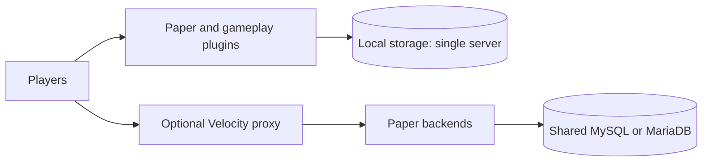

<p align="center">
  <a href="https://github.com/FolksyPizza/SMP-Core/releases/latest"></a>
  <a href="https://github.com/FolksyPizza/SMP-Core/actions/workflows/build.yml"></a>
  <a href="https://github.com/FolksyPizza/SMP-Core/stargazers"></a>
  <a href="https://github.com/FolksyPizza/SMP-Core/network/members"></a>
  <a href="LICENSE"></a>
  
</p>

# SMP-Core

Survival gameplay, economy and staff tools for Paper servers and Velocity networks.

[Get started](docs/getting-started.md) · [Commands](COMMANDS.md) · [Architecture](ARCHITECTURE.md) · [Releases](https://github.com/FolksyPizza/SMP-Core/releases) · [Contribute](CONTRIBUTING.md)

SMP-Core combines ten plugins and a shared library. Use it on a single survival server or configure a network
with shared storage. The current release is **1.0.0**; see the [changelog](CHANGELOG.md).

## What you can build

- A survival economy with shops, auctions and buy orders.
- Player tools for homes, teleport requests, friends, settings and expanded ender chests.
- Staff workflows for moderation, maintenance, audit and player inspection.
- A Velocity network with shared player state and a maintenance backend.

Single-server gameplay is stable. Network support is **beta**, and duels are **preview**.
Cross-server personal homes are not supported in the published release.
See [compatibility and limitations](docs/compatibility.md) before choosing a deployment.

## Get started

Use Java 21 or newer and a supported Paper server. Paper **1.21.11** has the most coverage;
Paper 1.21.7–1.21.10 has limited coverage. Folia and Paper 26.x are not supported.
ProtocolLib and Vault are required. A single server can use local storage; a network requires MySQL or MariaDB.

On macOS or Linux, clone the repository and run:

```sh
git clone https://github.com/FolksyPizza/SMP-Core.git
cd SMP-Core
./setup.sh            # starts onboarding
./server/start.sh
```

The setup script creates a server directory, installs dependencies and offers a branding profile.
Review its EULA and configuration choices before starting your server.
For manual installation and database setup, follow [Getting started](docs/getting-started.md).
For a proxy deployment, use the [network guide](network/).

## Architecture



PizzaNetworkCore owns gameplay and economy; support plugins own moderation and staff tools.
PizzaCommon embeds storage, scheduling and menu helpers in its consumers.
See [architecture](ARCHITECTURE.md) and [integrations](docs/integrations.md) for boundaries and limitations.

## Plugins

| Plugin | Purpose |
| --- | --- |
| PizzaNetworkCore | Core gameplay: auction house, buy orders, shop, homes, random teleport, teleport requests, friends and follows, `/ignore` and `/block`, duels and the duel queue, spawn and AFK hubs, chat item icons, per-player settings, leaderboards and the scoreboard |
| PizzaAdminTools | Staff tooling: admin menus, home administration, staff mode with an audit log, `/atrack`, maintenance freeze, transfers, `/stash`, `/nuke`, subscription tiers |
| PizzaPunishment | Bans, mutes (chat, private messages and Simple Voice Chat), strikes and death-drop penalties |
| PizzaChatGuard | Chat rate limits, duplicate detection and word lists |
| PizzaRuleGuard | Rule enforcement and abuse detection |
| EnderchestExpander | 54-slot ender chests with persistent storage and staff inspection (`/endersee`) |
| PizzaTune | Live view-distance and chunk-rate tuning |
| PizzaSpawnRules | Hub protections and double jump around 0,0. Active only on server port 25566 (hub) or 25569 (maintenance mirror); idle elsewhere |
| PizzaLimbo | Limbo backend that holds players during maintenance (proxy networks) |
| PizzaProxyGuard | Velocity plugin: holds new joins while the backend is down and turns moderation kicks into clean disconnects |
| PizzaCommon | Shared library compiled into the plugins that use it: storage, menu locking, the startup banner and a facade over Paper's schedulers |

## Documentation

| Task | Guide |
| --- | --- |
| Install or update | [Getting started](docs/getting-started.md) |
| Configure branding, storage and datapacks | [Configuration](docs/configuration.md) |
| Check platform support and limitations | [Compatibility](docs/compatibility.md) |
| Find commands and permissions | [Command reference](COMMANDS.md) |
| Understand plugin and storage boundaries | [Architecture](ARCHITECTURE.md) |
| Configure a Velocity network | [Network guide](network/) |
| Integrate another plugin | [APIs and integrations](docs/integrations.md) |
| Build and test a contribution | [Development guide](docs/development.md) |
| Deploy, maintain or roll back | [Operations](docs/operations.md) |
| Understand release and license scope | [Releases](docs/releases.md) |
| Check changes and planned work | [Changelog](CHANGELOG.md), [Upcoming](UPCOMING.md) |

## Build from source

The Gradle wrapper resolves dependencies from public repositories. Use Java 21 or newer:

```sh
./gradlew build
python3 tools/ci/check-licenses.py --jars build/dist
```

Jars are written to `build/dist/`. CI also runs `tools/ci/boot-check.sh`, which starts a disposable Paper server.
If running it locally, use a dedicated disposable work directory and an available port; the script deletes its work directory.
A clean boot establishes startup behavior; gameplay changes need focused runtime checks as well.

For repeatable commands, test coverage and remaining reproducibility limits, read the [development guide](docs/development.md).

## Contributing

Bug reports, documentation and focused fixes are welcome. Start with [CONTRIBUTING.md](CONTRIBUTING.md).
Report vulnerabilities through [SECURITY.md](SECURITY.md).

### Working with coding agents

Agent-assisted contributions follow [AGENTS.md](AGENTS.md) and the [agent contribution guide](docs/agent-contributions.md).
For substantial work, have a human review the proposed approach before implementation, then review the diff and
test evidence before merging. Return to human review if the scope or risk changes during implementation.
The contributor is responsible for every submitted change, including generated code, dependencies, licensing
and security. Agent output and passing checks do not replace human review.
An optional [SMP-Core change skill](skills/smp-core-change/SKILL.md) provides project-specific guidance.

## License

The current SMP-Core source code, documentation and build scripts use the Apache License, Version 2.0:
see [LICENSE](LICENSE) and [NOTICE](NOTICE). Releases before 1.0.0 retain the MIT License.
Third-party components retain their own licenses. PizzaProxyGuard bundles MariaDB Connector/J under the LGPL-2.1;
its license ships in the jar. Maintained by FolksyPizza.

CI checks the source licensing and each built jar's license metadata with
`python3 tools/ci/check-licenses.py --jars build/dist`.

Not an official Minecraft product. Not approved by or associated with Mojang or Microsoft.
